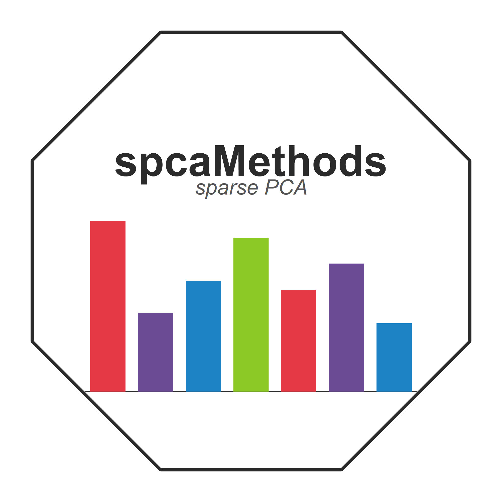

# Package spcaMethods

<!-- badges: start -->

<!--  -->

<!-- badges: end -->

This package contains functions to compute *conventional* SPCA methods,
that is methods that compute sparse PCA components by maximizing their
variance.

It is a companion to the **spca** package

LS-SPCA provides a close approximation to the PCs, thus something like
PCA with sparse weights.
